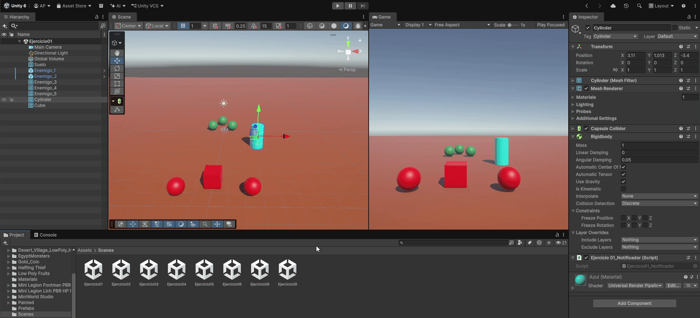
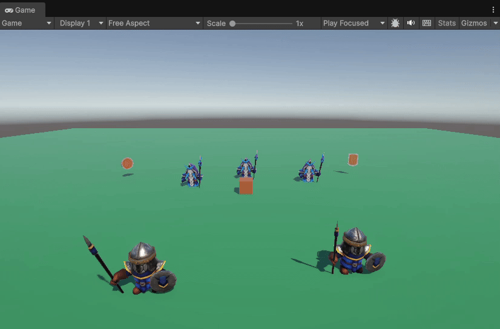

# Práctica 04. Eventos
- **Autor:** Adrián Pérez Poleo
- **Correo:** alu0101635224@ull.edu.es

## Índice

## Introducción

## Ejercicio 01
Los ficheros de código se encuentran en: 

### Descripción

### Implementación

### Ejecución

## Ejercicio 02
### Descripción

### Implementación

### Ejecución

## Ejercicio 03
Los ficheros de código se encuentran en: 

### Descripción

### Implementación

### Ejecución

## Ejercicio 04

## Ejercicio 05

## Ejercicio 06

## Ejercicio 07

## Ejercicio 08

## Ejercicio 09
